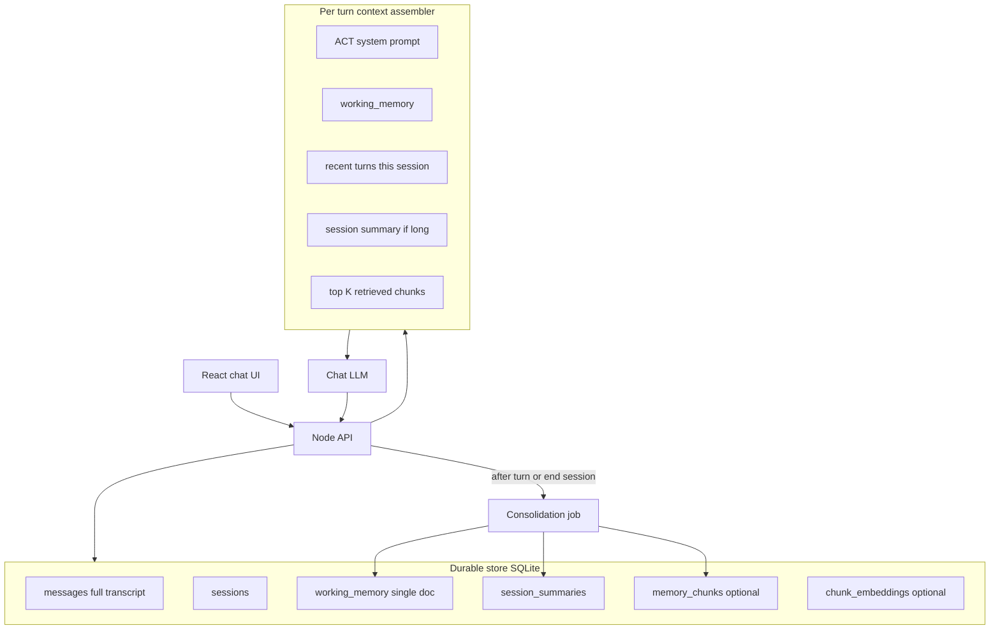
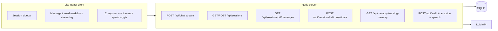

# Holly

Local ACT therapy companion — Cursor-style chat UI with long-term memory across sessions.

Greenfield **Vite + React + TypeScript + Tailwind** app with a local **Node (Hono) API**, streaming chat, ACT persona in [AGENTS.md](AGENTS.md), and a hybrid **SQLite memory pipeline** (transcripts + rolling working memory + semantic recall) so Holly remembers prior sessions without stuffing full history into every prompt.

## Setup

```bash
cp .env.example .env
# Add LLM_API_KEY (OpenAI or any OpenAI-compatible API)
npm install
npm run dev
```

Open [http://localhost:5199](http://localhost:5199). The API runs on port 3011.

### Environment

```bash
# .env.example
LLM_API_KEY=
LLM_MODEL=gpt-5-mini   # omit LLM_TEMPERATURE for gpt-5 / o-series (default only)
LLM_BASE_URL=           # optional, for OpenRouter/custom
# LLM_STT_MODEL=whisper-1
# LLM_TTS_MODEL=tts-1
# LLM_TTS_VOICE=nova    # warm female voice for Holly (OpenAI voices: nova, shimmer, …)
PORT=3011
VITE_PORT=5199
# VITE_DEV_HTTPS=true   # self-signed HTTPS for LAN + microphone on phones
```

### Voice conversation

Holly supports optional **voice input** (mic in the composer) and **spoken replies** (toggle in the composer footer). Speech is transcribed and synthesized through **server-side proxies** (`POST /api/audio/transcribe`, `POST /api/audio/speech`) using the same `LLM_API_KEY` and `LLM_BASE_URL` as chat — the key never reaches the browser. Configure optional `LLM_STT_MODEL`, `LLM_TTS_MODEL`, and `LLM_TTS_VOICE` in `.env`.

If the server audio routes are unavailable or fail, the UI falls back to the **Web Speech API** (browser speech recognition / synthesis). Raw audio is not stored; only transcribed text enters the normal message flow.

**LAN / phones:** Vite binds to `0.0.0.0` so you can open Holly from other devices on your network. Microphones require a [secure context](https://developer.mozilla.org/en-US/docs/Web/Security/Secure_Contexts) (HTTPS or localhost). For phone testing over Wi‑Fi, set `VITE_DEV_HTTPS=true`, restart `npm run dev`, and accept the self-signed certificate in the browser. HTTP on `localhost` still works on your Mac without HTTPS.

## Scripts

| Command | Description |
|---------|-------------|
| `npm run dev` | Vite + API (concurrently) |
| `npm run build` | Production client build |
| `npm run lint` | ESLint |
| `npm run server` | API only |

---

## Build plan

### Tech stack

- **TypeScript** — strict typing across client and server
- **React** — component-based chat UI
- **Tailwind CSS** — utility-first styling (with typography plugin for markdown)
- **ESLint** — code quality
- **Vite** — dev server and production client builds
- **Hono** — local HTTP API
- **SQLite + Drizzle** — persistence (`data/holly.db`, gitignored)
- **OpenAI-compatible chat API** — streaming completions

### Agent runtime

Use a **small local backend** that calls a **chat-completions API with streaming** (OpenAI, Anthropic, or OpenRouter — one provider via env config). Do **not** use the Cursor SDK as Holly’s runtime:

| Approach | Fit for Holly |
|----------|----------------|
| Chat LLM API + your prompt/memory | Purpose-built for multi-turn dialogue, predictable cost, full control over ACT prompt and memory injection |
| Cursor SDK (`Agent.create` / `resume`) | Optimized for code/repo agents and tool use; poor fit for a personal therapy UI and long-horizon memory you own |

The **embedded agent** is: system prompt (ACT) + **context assembler** (memory layers) + **streaming completion handler**, exposed as `POST /api/chat` (SSE).

**Deployment (current):** single-user, local — no auth; SQLite under `data/holly.db`; LLM key in `.env` (never committed).

### Long-term memory design

You cannot rely on sending the full transcript forever (context limits, cost, “lost in the middle,” and noise). The pattern that works best for **months of therapy-style dialogue** is a **hybrid memory stack**: always keep the full archive, but **assemble** each turn from a small, curated context package.



#### Memory layers

1. **Canonical transcript (source of truth)**  
   Every user/assistant message stored with `session_id`, `role`, `content`, `created_at`. Used for UI history, audit, and consolidation.

2. **Rolling working memory (always injected)**  
   One maintained markdown document (≈800–1500 tokens), updated after each session, containing ACT-relevant continuity: **values**, **committed actions**, **themes**, **metaphors/exercises**, patterns to gently challenge, and **sensitivities** (pacing, not reassurance).

3. **Session summaries (injected when relevant)**  
   Short summary per closed session. New sessions get the last 1–3 summaries plus working memory.

4. **Recent raw turns (short window)**  
   Last ~40 messages of the **current** session verbatim.

5. **Semantic recall**  
   After consolidation, message chunks are embedded locally (`@xenova/transformers`, `all-MiniLM-L6-v2`) and top-K chunks are retrieved into the prompt from the latest user message + working memory.

#### Consolidation

Run when the user clicks **New session** (`POST /api/sessions/:id/consolidate`):

- Input: session transcript + previous `working_memory`
- LLM call with a **strict extractor prompt** ([`prompts/consolidate-system.md`](prompts/consolidate-system.md)) — no therapy voice
- Output: updated `working_memory`, new `session_summary`, re-indexed chunks/embeddings

#### What to avoid

- Opaque agent IDs with no local DB — loses portability and control
- Vector RAG alone — misses values/commitments that do not match queries
- One giant summary alone — pair summary with structured working memory

#### Safety / scope

- UI disclaimer: Holly is **ACT-style support**, not licensed therapy or crisis care
- System prompt: crisis routing (e.g. 988 in the US) when imminent harm is expressed — see [`prompts/holly-system.md`](prompts/holly-system.md)

### Application architecture



#### Repository layout

| Path | Purpose |
|------|---------|
| [AGENTS.md](AGENTS.md) | Cursor instructions + full ACT Holly prompt |
| [prompts/holly-system.md](prompts/holly-system.md) | Runtime ACT system prompt (server loads this) |
| [prompts/consolidate-system.md](prompts/consolidate-system.md) | Memory extractor prompt |
| [src/](src/) | React UI |
| [server/](server/) | Hono API, memory, context assembly |
| [data/](data/) | Local SQLite (gitignored) |

**Dev:** Vite proxies `/api` → `http://127.0.0.1:3011` (ports configurable via `.env`).

#### Key implementation files

- [`server/context/buildPrompt.ts`](server/context/buildPrompt.ts) — memory assembly per turn
- [`server/routes/chat.ts`](server/routes/chat.ts) — SSE streaming + persist messages
- [`server/memory/consolidate.ts`](server/memory/consolidate.ts) — post-session extractor
- [`server/memory/embeddings.ts`](server/memory/embeddings.ts) — chunk index + retrieval
- [`src/App.tsx`](src/App.tsx) — session flow and chat wiring

### Chat UI (Cursor-like)

- **Layout:** session list (left), scrollable thread, bottom composer (Enter send, Shift+Enter newline)
- **Messages:** user vs Holly; streaming markdown; Holly avatar initial
- **Actions:** New session (consolidates prior session), **What Holly remembers** (read-only working memory)
- **Components:** `SessionSidebar`, `ChatThread`, `MessageBubble`, `Composer`, `StreamingMarkdown`, `MemoryPanel`

### Holly persona

- Name: **Holly** — warm, direct, ACT-grounded ([`prompts/holly-system.md`](prompts/holly-system.md))
- **First-ever opening:** *“What’s showing up for you right now that you’d like to explore together?”*
- **Returning sessions:** continuity comes from injected working memory and summaries in the system context, not a repeated stock greeting

### Data model (SQLite)

| Table | Purpose |
|-------|---------|
| `sessions` | `id`, `title`, `created_at`, `updated_at`, `consolidated_at` |
| `messages` | `id`, `session_id`, `role`, `content`, `created_at` |
| `working_memory` | singleton row: `content`, `updated_at` |
| `session_summaries` | `session_id`, `summary`, `created_at` |
| `memory_chunks` | `session_id`, `text`, `start_message_id` |
| `chunk_embeddings` | `chunk_id`, embedding JSON |

### Implementation phases

| Phase | Scope | Status |
|-------|--------|--------|
| **1 — MVP** | Scaffold, SQLite APIs, streaming chat, ACT prompt, sidebar UI, consolidation on new session | Done |
| **2 — Deep recall** | Local embeddings + retrieval; “What Holly remembers” panel | Done |
| **3 — Polish** | Export transcripts; optional DB encryption at rest | Not started |

Phase 3 items still open: export transcript (markdown/json), optional encryption for `data/holly.db`.

---

See [AGENTS.md](AGENTS.md) for contributor/agent instructions and the full ACT prompt text.
